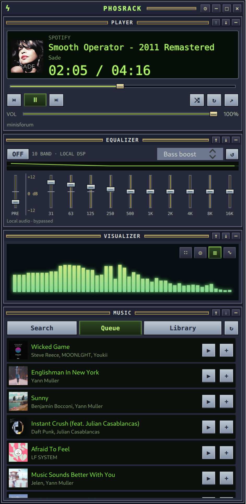

# Phosrack

**0.3.1 · QML + C++ desktop music rack** · GPL-3.0-or-later

A compact media-player rack inspired by the classic Winamp era, with modular panels,
a real local equalizer and an original fullscreen audio visualizer.

[Getting started](GETTING_STARTED.md) · [Installers](releases/v0.3.1/) ·
[Build and packaging](docs/packaging.md) · [Windows](docs/windows.md) ·
[Validation](docs/validation-0.3.1.md) · [Issues](https://github.com/minibota/phosrack/issues)

## Screenshot

Phosrack in English with Spotify playback, the equalizer, live spectrum visualization and the queue.

## Features

- Stackable, reorderable and collapsible player, visualizer, EQ and music panels.
- Artwork, playback position, volume, previous/next, shuffle and repeat.
- Search, queue and library views, including saved tracks, albums and playlists.
- Ten EQ bands, preamp, Flat/Rock/Pop/Jazz/Classical/Bass boost/Vocal presets and
  persistent custom gains.
- Orbit, Spectrum and Oscilloscope visualization, reduced motion, fullscreen mode,
  and an overlay for the current and next track.
- English, Spanish and French selected from the system language; English fallback.
- Connect Spotify directly using browser authorization with PKCE; no Client ID setup for normal use.
- Protected session storage: KWallet on Linux and Windows Credential Manager on Windows.

The application embeds its QML, icon and translation catalogs. It does not require
Plasma or a globally installed QML plugin. Spotify playback uses an existing player;
no private Spotify APIs, borrowed application credentials or librespot are used.

## Install

Download the package for your platform from [releases/v0.3.1](releases/v0.3.1/).
Linux formats are RPM (Fedora 45 x86_64), DEB (Debian 13 amd64) and Flatpak.
The Windows workflow produces an x64 installer and portable ZIP using MSVC.

To update an existing user Flatpak installation with the downloaded bundle:

    flatpak install --user --reinstall ./phosrack-0.3.1-x86_64.flatpak

Follow [GETTING_STARTED.md](GETTING_STARTED.md) for installation, including the
per-command digest verification needed for unsigned development RPMs. Check
[validation notes](docs/validation-0.3.1.md) for completed build/runtime checks; a successful
Windows compilation does not by itself verify WASAPI or Equalizer APO on real hardware.

## Spotify setup and scope

Open Settings, click **Connect Spotify** and authorize your own Spotify account in
your browser. Release builds include Phosrack's public Client ID; you do not need to
create a developer application or enter credentials in Phosrack. Each person signs
in to their own account. A Client Secret is never required.

The bundled application is in Spotify development mode. Its owner must retain
Premium, and Spotify limits new development applications to five authenticated
users who must be added to the application's allowlist. Being able to open the
login page does not grant API access. Public downloads do not remove these limits;
see [Spotify's quota modes](https://developer.spotify.com/documentation/web-api/concepts/quota-modes).
Playback controls also require Premium and an active Spotify playback device.

Developers can expand **Advanced Spotify settings** in Settings to use their own application. Enable
Web API and register exactly `http://127.0.0.1:43821/callback` in its Developer Dashboard.
For your own builds, override the public ID at configuration time with
`-DPHOSRACK_SPOTIFY_CLIENT_ID=YOUR_32_CHARACTER_CLIENT_ID`; see the
[packaging guide](docs/packaging.md#spotify-application-configuration).

The requested permissions cover playback, saved library and playlists. Older 0.1
sessions need reauthorization for library permissions. Development-mode search is
limited to ten results per content type per page; playlist contents can be read only
for owned/collaborative playlists. The application handles restrictions, empty playback,
token refresh and request throttling.

This project is independent of Spotify and is not presented as Spotify-approved.
Use of the official API does not establish compliance of every combined feature.
The developer policy's visual-media and core-experience provisions still need to be
resolved before representing the application as an approved public Spotify client.
Publishing source does not grant additional API access or permission.

## Build from source

Qt 6.5 or later and a C++17 compiler are required.

Fedora 45 build dependencies:

    sudo dnf install gcc-c++ cmake ninja-build pkgconf-pkg-config qt6-qtbase-devel qt6-qtdeclarative-devel kf6-kwallet-devel extra-cmake-modules pipewire-devel pipewire-utils

Debian 13 build dependencies:

    sudo apt install build-essential cmake ninja-build pkg-config qt6-base-dev qt6-declarative-dev libkf6wallet-dev extra-cmake-modules libpipewire-0.3-dev qml6-module-qtquick-controls qml6-module-qtquick-layouts qml6-module-qtquick-window qml6-module-qtqml-workerscript qml6-module-qttest pipewire-bin

Then build and run:

    cmake -S . -B build -G Ninja -DCMAKE_BUILD_TYPE=Release
    cmake --build build --parallel
    ctest --test-dir build --output-on-failure
    ./build/phosrack

For a user-local Linux installation, run:

    bash scripts/install-user.sh

Windows uses MSVC 2022 and the Qt Windows SDK, without KWallet or Linux PipeWire.
See [docs/windows.md](docs/windows.md). Packages are built with their target
distribution/toolchain; Fedora binaries are not converted into Debian packages.

## Local audio

On Linux, the visualizer follows the actual default PipeWire output. A separate
phosrack-eq-worker owns a virtual Audio/Sink and a playback stream pinned to the selected
physical output. Its local ten-band biquad DSP accepts live gains over private stdin
without restarting the stream or requiring a PipeWire manager permission.

Enable EQ, then choose **Phosrack EQ** as the player output in the system sound settings.
Phosrack does not silently change the default output or move other applications.
Disabling EQ or closing the application removes the temporary sink. A lower preamp
provides headroom when bands are boosted.

On Windows, visualization uses WASAPI loopback of the playback device. EQ integrates
with an optional, separately installed Equalizer APO driver. Configure the playback
device in Equalizer APO and choose its configuration folder in Phosrack Settings.
Phosrack preserves unrelated configuration, creates a backup and writes its own
filter include. The driver itself is not bundled.

Visual analysis includes all local audio on the selected output, potentially including
other apps and notifications. It does not receive sound from remote Spotify devices.
Hiding/folding the visualizer or minimizing its last visible window stops monitoring.
Raw samples are processed in memory, without audio files or uploads.

Fullscreen metadata comes from actual Spotify playback and queue data; unavailable
information is shown explicitly. Escape or the close button returns to the rack.

## Development and license

See [CONTRIBUTING.md](CONTRIBUTING.md), [SECURITY.md](SECURITY.md),
[architecture.md](docs/architecture.md) and [LICENSE](LICENSE).
Artwork and effects are original; no Winamp or Windows Media Player assets are bundled.
Phosrack is independent of Spotify, Winamp, KDE and Microsoft.

The repository is https://github.com/minibota/phosrack. Installable artifacts are kept
under releases/v0.3.1/. Fully detachable rack panels remain future work.

## Primary references

- https://developer.spotify.com/documentation/web-api/tutorials/code-pkce-flow
- https://developer.spotify.com/documentation/web-api/concepts/quota-modes
- https://developer.spotify.com/documentation/web-api/tutorials/february-2026-migration-guide
- https://developer.spotify.com/policy
- https://docs.pipewire.org/
- https://doc.qt.io/qt-6.8/windows-deployment.html
- https://docs.flatpak.org/en/latest/sandbox-permissions.html
